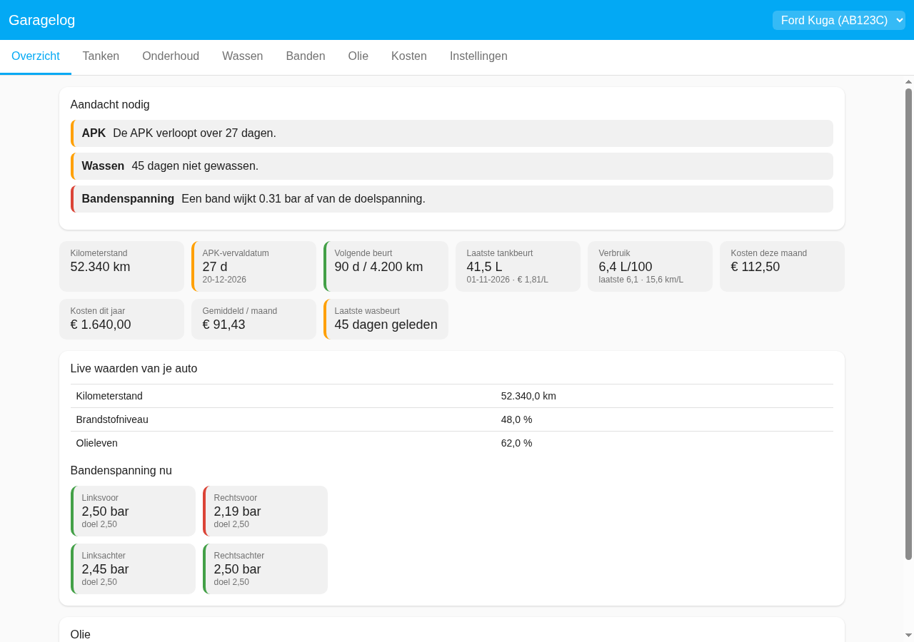
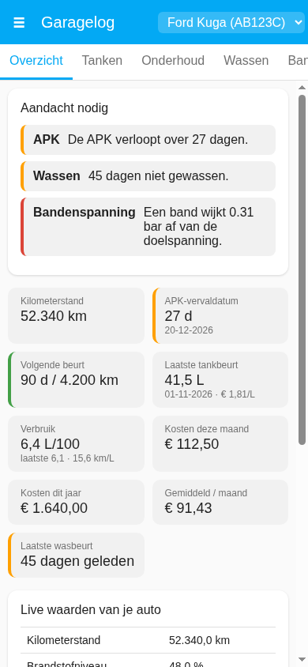
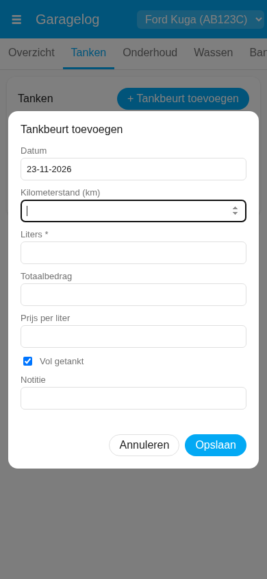

# Garagelog

**Garagelog: car management for Home Assistant** — fuel log, consumption and costs, maintenance, APK, washing, tyre pressure
and oil, in one standalone integration. No cloud account, no app, no server: everything is stored in Home Assistant.

> Status: **0.7.5 (sidebar panel, fuel prices), only tried in automated tests and in a first install on the author's Home Assistant.** See `docs/testen.md`.

## What it does

- **One entry per vehicle.** Enter the licence plate: the RDW (open data, no key) fills in make, model, fuel and the **APK expiry date**.
- **Source entities.** Optionally pick the entities your car already provides (odometer, fuel level, tyre pressures, oil life %,
  for example from FordConnect). Tyre pressures: pick four sensors, or one sensor that carries `frontLeft`,
  `frontRight`, `rearLeft` and `rearRight` as attributes (for example "2.53 bar"). Everything else you log by hand.
- **Refuel log** (`garagelog.log_refuel`): consumption in km/L (full-tank method; the sensors also carry `l_per_100km`), cost, price per litre, totals.
- **Maintenance log** (`garagelog.log_service`) with next service in days and km.
- **APK reminder** 30 days ahead, once per APK date.
- **Washing:** days since the last wash; reminders at 30 and 60 days.
- **Tyres:** deviation from the target pressure; one message per pressure dip (>= 0.2 bar by default).
- **Oil:** check reminder on the first weekend day on/after the 25th; estimated oil change from the oil-life percentage (labelled as an estimate).
- **Costs:** total, this year, this month, average per month.
- **Reminders** are events (`garagelog_apk_due`, `garagelog_service_due`, `garagelog_wash_due`, `garagelog_tyre_pressure`,
  `garagelog_oil_check_due`, `garagelog_oil_change_due`) and messages to the notify targets you choose (Telegram, phone, ...).
- **Fuel prices** (0.3.0): pick the sensors that hold a station's price per litre (for example scrape sensors) under Settings. The panel tab
  "Fuel prices" shows every station with its last price change, the cheapest station and the gap, what filling up costs per station (with the car's
  tank size and fuel level), a price history chart, hints (price vs. its own average, cheapest weekday) and the changes per station. Only price
  changes are stored (one year). Per station you can add an optional text sensor (0.4.0) whose state is shown on the card, for example the
  station's name and address; it is also kept with every logged price, so the history shows which station it was. A **notification per price change** (per station, optional minimum change) works like the Keepr app. Every notification type can be switched on or off in the settings. Sensor `cheapest_fuel_price` for automations.
- **Monthly report** (0.7.0): the tab "Report" shows a month (default: last month) with costs, distance, litres, consumption, average price, cost per km, the
  change against the previous month and the fill-up and maintenance tables. The button prints it or saves it as a PDF through the browser.
- **Location** (0.6.0): pick the car's `device_tracker` in the settings; the tab "Location" shows the last 24 hours on a map (Leaflet + OpenStreetMap, loaded
  from a CDN) with a list of stops and their addresses (OpenStreetMap Nominatim, looked up in your browser and remembered there).
- **Tyre pressure log** (0.5.0): the four pressures are logged automatically on Wednesday and Sunday from 08:00 (tab Tyres, also editable by hand); a message follows when that is not possible, and when the pressure is back to normal after a warning.
- A **sidebar panel** "Garagelog" (icon `mdi:car`): a full page per vehicle with an overview (warnings, APK, next service, last refuel,
  consumption, costs, live source values, tyre pressure per wheel shown on a car outline, oil life), log tabs (fuel, maintenance, washing, tyres, oil) with add / edit /
  delete, a cost tab with a stacked monthly chart and a period filter, and a settings tab. Several vehicles are chosen in the header; on a phone
  the menu button opens the Home Assistant sidebar. Optionally only for administrators (setting "Sidebar panel for admins only").
- A **dashboard card** (`garagelog-card`) with the status of the vehicle and quick buttons (refuel, washed, oil checked).
- English and Dutch.

## Install (when published)

HACS / Marketplace: add the repository as a custom repository (category Integration), install **Garagelog**, restart, then
Settings → Devices & services → Add integration → **Garagelog**.

## Services

All take `entity_id` (any Garagelog entity of the vehicle) and return the stored record (with its `id`).

| Service | Fields |
|---|---|
| `garagelog.log_refuel` | `liters`, `total_cost` or `price_per_litre`, `odometer` (default: the source odometer), `full` (default true), `date`, `note` |
| `garagelog.log_service` | `type` (maintenance, oil_change, tyres, brakes, apk, repair, other), `cost`, `odometer`, `next_due_date`, `next_due_odometer`, `date`, `note` |
| `garagelog.log_wash` | `cost`, `date`, `note` |
| `garagelog.log_oil_check` | `level`, `added_litres`, `odometer`, `date`, `note` |
| `garagelog.remove_record` | `collection`, `id` |
| `garagelog.refresh_rdw` | refresh the RDW data (APK date) |

## Sidebar panel

The panel appears in the sidebar as soon as a vehicle is set up and disappears with the last one. Tabs: Overview, Fuel, Maintenance, Washing,
Tyres, Oil, Costs, Settings. Dates are typed as dd-mm-yyyy. The settings tab changes the same options as Configure on the integration.

| Desktop | Phone |
|---|---|
|  |  |
|  |  |

## Card

```yaml
type: custom:garagelog-card
entity: sensor.ford_kuga_ab123c_odometer
```

## Limitations (0.1.0)

Single currency (the Home Assistant currency); no export/import service yet (format in `docs/ontwerp.md`); tankbeurten are not detected
from the fuel level. The tyre tab logs tyre changes and repairs as maintenance entries; tyre pressure itself is read from the source entities, not logged. The oil-change figure is an extrapolation, not a measurement.

Design: `docs/ontwerp.md`. Why this exists next to Vehicle Log and others: `docs/vergelijking.md`.

## License

MIT, see `LICENSE`.
