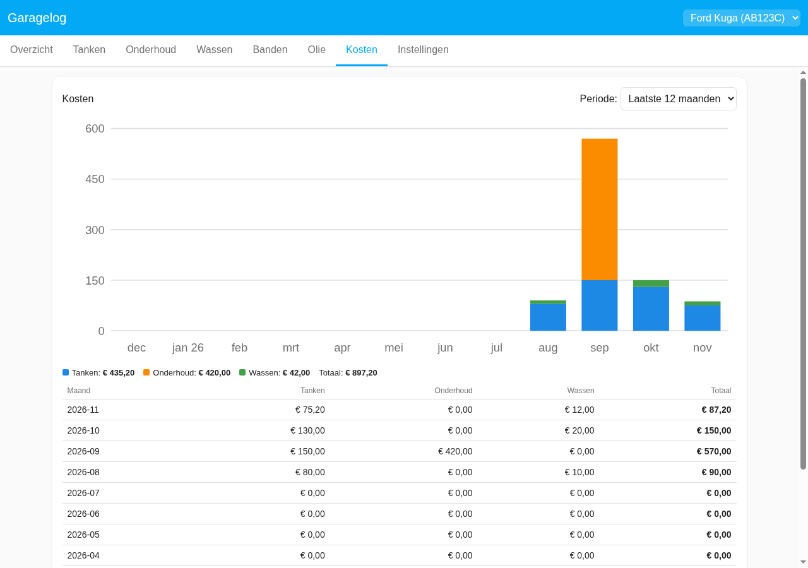

# Garagelog

**Garagelog: car management for Home Assistant** — fuel log, consumption and costs, maintenance, APK, washing, tyre pressure
and oil, in one standalone integration. No cloud account, no app, no server: everything is stored in Home Assistant.

> Status: **0.2.1 (sidebar panel with car-outline tyre pressures), only tried in automated tests and in a first install on the author's Home Assistant.** See `docs/testen.md`.

## What it does

- **One entry per vehicle.** Enter the licence plate: the RDW (open data, no key) fills in make, model, fuel and the **APK expiry date**.
- **Source entities.** Optionally pick the entities your car already provides (odometer, fuel level, tyre pressures, oil life %,
  for example from FordConnect). Everything else you log by hand.
- **Refuel log** (`garagelog.log_refuel`): consumption in L/100 km and km/L (full-tank method), cost, price per litre, totals.
- **Maintenance log** (`garagelog.log_service`) with next service in days and km.
- **APK reminder** 30 days ahead, once per APK date.
- **Washing:** days since the last wash; reminders at 30 and 60 days.
- **Tyres:** deviation from the target pressure; one message per pressure dip (>= 0.2 bar by default).
- **Oil:** check reminder on the first weekend day on/after the 25th; estimated oil change from the oil-life percentage (labelled as an estimate).
- **Costs:** total, this year, this month, average per month.
- **Reminders** are events (`garagelog_apk_due`, `garagelog_service_due`, `garagelog_wash_due`, `garagelog_tyre_pressure`,
  `garagelog_oil_check_due`, `garagelog_oil_change_due`) and messages to the notify targets you choose (Telegram, phone, ...).
- A **sidebar panel** "Garagelog" (icon `mdi:car`): a full page per vehicle with an overview (warnings, APK, next service, last refuel,
  consumption, costs, live source values, tyre pressure per wheel shown on a car outline, oil life), log tabs (fuel, maintenance, washing, tyres, oil) with add / edit /
  delete, a cost tab with a stacked monthly chart and a period filter, and a settings tab. Several vehicles are chosen in the header; on a phone
  the menu button opens the Home Assistant sidebar. Optionally only for administrators (setting "Sidebar panel for admins only").
- A **dashboard card** (`garagelog-card`) with the status of the vehicle and quick buttons (refuel, washed, oil checked).
- English and Dutch.

## Install (when published)

HACS / Marketplace: add the repository as a custom repository (category Integration), install **Garagelog**, restart, then
Settings → Devices & services → Add integration → **Garagelog**.

## Services

All take `entity_id` (any Garagelog entity of the vehicle) and return the stored record (with its `id`).

| Service | Fields |
|---|---|
| `garagelog.log_refuel` | `liters`, `total_cost` or `price_per_litre`, `odometer` (default: the source odometer), `full` (default true), `date`, `note` |
| `garagelog.log_service` | `type` (maintenance, oil_change, tyres, brakes, apk, repair, other), `cost`, `odometer`, `next_due_date`, `next_due_odometer`, `date`, `note` |
| `garagelog.log_wash` | `cost`, `date`, `note` |
| `garagelog.log_oil_check` | `level`, `added_litres`, `odometer`, `date`, `note` |
| `garagelog.remove_record` | `collection`, `id` |
| `garagelog.refresh_rdw` | refresh the RDW data (APK date) |

## Sidebar panel

The panel appears in the sidebar as soon as a vehicle is set up and disappears with the last one. Tabs: Overview, Fuel, Maintenance, Washing,
Tyres, Oil, Costs, Settings. Dates are typed as dd-mm-yyyy. The settings tab changes the same options as Configure on the integration.

| Desktop | Phone |
|---|---|
|  |  |
|  |  |

## Card

```yaml
type: custom:garagelog-card
entity: sensor.ford_kuga_ab123c_odometer
```

## Limitations (0.1.0)

Single currency (the Home Assistant currency); no export/import service yet (format in `docs/ontwerp.md`); tankbeurten are not detected
from the fuel level. The tyre tab logs tyre changes and repairs as maintenance entries; tyre pressure itself is read from the source entities, not logged. The oil-change figure is an extrapolation, not a measurement.

Design: `docs/ontwerp.md`. Why this exists next to Vehicle Log and others: `docs/vergelijking.md`.

## License

MIT, see `LICENSE`.
